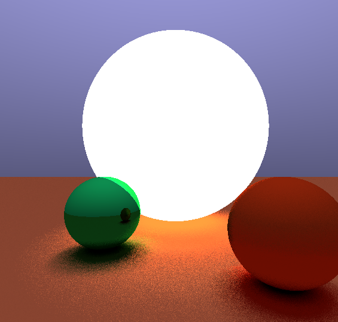

# JTracer

Ray tracer in Java



## Features

- [X] Multithreaded rendering
- [X] Embedded scene description markup language
- [X] Realistic material properties
- [X] Basic geometry vs ray intersections
- [X] Light sources
- [X] Organized package structure
- [X] Extendible by external code
- [X] Demo scenes
- [ ] Refraction
- [ ] Triangle Meshes

## DSL

Structure
```
TypeName declName {
    propertyName = 2.5;
    propertyName = "value";
    propertyName = [1, 2, 3];

    propertyName = 2.5 + 7.5;
    propertyName = [1 * 2, 1 - 2, 1 / 2];
}
```
